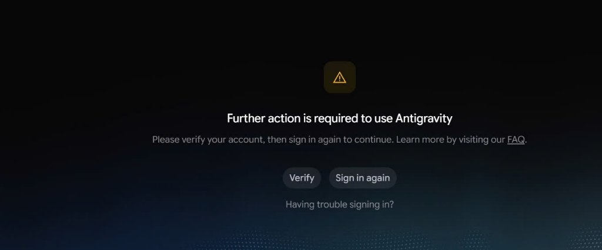
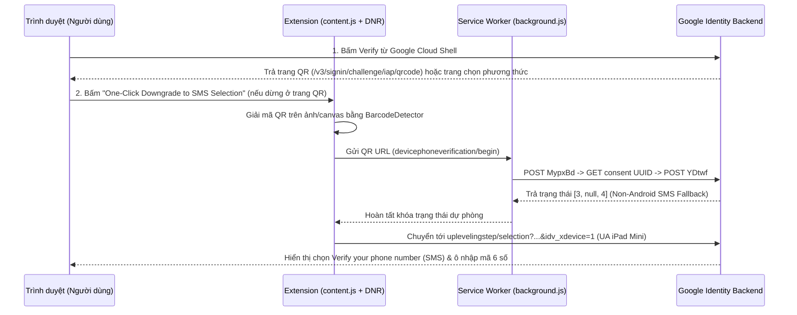

<div align="center">

# Google QR SMS Helper

<p><strong>Tiện ích mở rộng Chrome (Manifest V3) giúp chuyển bước xác minh QR bắt buộc của Google về lại xác minh qua mã SMS 6 chữ số truyền thống — khắc phục nhanh lỗi kẹt xác minh trên Antigravity, Gemini Code Assist và Google Cloud Shell.</strong></p>

<p>
  
  
  
  
</p>

<p>
  <a href="#lỗi-thường-gặp--vấn-đề-repo-này-giải-quyết">Lỗi thường gặp</a> &nbsp;·&nbsp;
  <a href="#video-hướng-dẫn-chi-tiết">Video hướng dẫn</a> &nbsp;·&nbsp;
  <a href="#hướng-dẫn-cài-đặt">Cài đặt</a> &nbsp;·&nbsp;
  <a href="#hướng-dẫn-sử-dụng-từng-bước">Sử dụng</a> &nbsp;·&nbsp;
  <a href="#câu-hỏi-thường-gặp-faq">FAQ</a>
</p>

</div>

---

## Mục lục

- [Lỗi thường gặp & Vấn đề repo này giải quyết](#lỗi-thường-gặp--vấn-đề-repo-này-giải-quyết)
- [Video hướng dẫn chi tiết](#video-hướng-dẫn-chi-tiết)
- [Hướng dẫn cài đặt](#hướng-dẫn-cài-đặt)
  - [Cách 1: Tải file ZIP trực tiếp (Khuyên dùng)](#cách-1-tải-file-zip-trực-tiếp-khuyên-dùng)
  - [Cách 2: Cài đặt qua Git Clone](#cách-2-cài-đặt-qua-git-clone)
- [Hướng dẫn sử dụng từng bước](#hướng-dẫn-sử-dụng-từng-bước)
- [Nguyên lý hoạt động & Cấu trúc dự án](#nguyên-lý-hoạt-động--cấu-trúc-dự-án)
  - [Luồng xử lý kỹ thuật](#luồng-xử-lý-kỹ-thuật)
  - [Cấu trúc thư mục](#cấu-trúc-thư-mục)
- [Câu hỏi thường gặp (FAQ)](#câu-hỏi-thường-gặp-faq)
- [Tài nguyên liên quan](#tài-nguyên-liên-quan)
- [Credits & References](#credits--references)

---

## Lỗi thường gặp & Vấn đề repo này giải quyết

Khi đăng nhập hoặc sử dụng **Google Antigravity**, **Gemini Code Assist**, **Gemini CLI** hoặc **Google Cloud Shell**, nhiều tài khoản gặp thông báo chặn như hình dưới đây:

> **`Further action is required to use Antigravity`**
> *Please verify your account, then sign in again to continue. Learn more by visiting our FAQ.*



Khi bạn bấm **`Verify`**, Google trên trình duyệt máy tính thường ép sang màn hình **quét mã QR bằng điện thoại Android** (`Verify your info to continue — Scan the QR code with your phone`) và không cho nhập số điện thoại nhận SMS trực tiếp. Điều này gây kẹt nếu bạn không mang máy Android đang đăng nhập sẵn tài khoản đó hoặc dùng số điện thoại nhận OTP riêng.

**`Google QR SMS Helper` giải quyết triệt để vấn đề này bằng cách:**
- Tự động nhận diện trang QR xác minh (`/challenge/iap/qrcode`) và giải mã URL QR ngay trên trình duyệt bằng `BarcodeDetector`.
- Gửi yêu cầu chuyển trạng thái sang luồng dự phòng không dùng Android (`[3, null, 4]`) và giữ nguyên chữ ký thiết bị **`iPad Mini`** xuyên suốt qua `declarativeNetRequest` + `ua_spoof.js`.
- Mở khóa lại tùy chọn **Verify your phone number (nhận mã SMS 6 chữ số `G-xxxxxx`)**, giúp tài khoản vượt qua bước kiểm tra một lần để dùng tiếp Antigravity / Cloud Shell bình thường.

---

## Video hướng dẫn chi tiết

Xem hoặc tải video quay màn hình thao tác thực tế từ lúc gặp lỗi đến khi xác minh xong và vào lại Antigravity thành công:

- **Xem / Tải video:** [Xem / Tải video hướng dẫn thực tế (docs/QR.mp4 — 8,26 MB)](./docs/QR.mp4)
- **Link tải trực tiếp (Raw):** https://github.com/namxely/google-qr-sms-helper/raw/main/docs/QR.mp4

| Mốc thời gian | Nội dung thao tác trong video `QR.mp4` |
|---|---|
| `00:00 – 00:20` | Gặp lỗi **`Further action is required to use Antigravity`**; bấm `Verify` bị chuyển sang trang bắt quét mã QR. |
| `00:21 – 00:58` | Mở `https://shell.cloud.google.com/?show=ide%2Cterminal`, kích hoạt Cloud Shell và bấm **`Verify`** ở hộp thoại xác minh. |
| `01:05 – 01:15` | Mở `chrome://extensions/`, bật **Developer mode** và nạp thư mục dự án bằng **Load unpacked**. |
| `01:16 – 02:15` | Tải lại trang Cloud Shell → bấm **`Verify`** → chọn **`Verify your phone number`** → nhập SĐT & mã `G-xxxxxx` → hoàn tất mở khóa tài khoản. |
| `02:16 – 02:41` | Quay lại Antigravity → bấm **`Verify`** → trình duyệt báo **`Authentication successful`** và mở khóa thành công. |

---

## Hướng dẫn cài đặt

Vì tệp `manifest.json` được đặt ngay tại thư mục gốc của repo, bạn có thể tải về và nạp trực tiếp vào trình duyệt nhân Chromium (**Chrome**, **Microsoft Edge**, **Brave**) mà không cần build lại.

### Cách 1: Tải file ZIP trực tiếp (Khuyên dùng)

1. Bấm nút **`<> Code`** màu xanh ở đầu trang này → chọn **`Download ZIP`**.
2. Giải nén tệp `.zip` vừa tải về thành một thư mục trên máy (ví dụ: `google-qr-sms-helper-main`).
3. Mở trình duyệt Chrome / Edge / Brave, nhập **`chrome://extensions/`** vào thanh địa chỉ và nhấn **Enter**.
4. Bật công tắc **Developer mode** (*Chế độ dành cho nhà phát triển*) ở góc trên bên phải.
5. Bấm nút **Load unpacked** (*Tải tiện ích đã giải nén*) ở góc trên bên trái và chọn **thư mục vừa giải nén** (thư mục chứa `manifest.json`).

### Cách 2: Cài đặt qua Git Clone

```bash
git clone https://github.com/namxely/google-qr-sms-helper.git
```

Sau đó mở **`chrome://extensions/`**, bật **Developer mode**, bấm **Load unpacked** và chọn thư mục `google-qr-sms-helper`.

---

## Hướng dẫn sử dụng từng bước

> [!IMPORTANT]
> **Lưu ý quan trọng trước khi chạy:** **Không** bấm hạ cấp trực tiếp trên trang QR do cửa sổ Antigravity / bên thứ ba mở ra, vì tham số `continue` của trang đó chứa nhiều tầng chuyển hướng lồng nhau khiến Google đẩy bạn quay lại màn hình QR.
> Hãy mở xác minh từ **Google Cloud Shell** (`https://shell.cloud.google.com/?show=ide%2Cterminal` hoặc `https://console.cloud.google.com/`) trước. Sau khi xác minh SMS thành công tại đó một lần, trạng thái tài khoản Google sẽ được mở khóa trên toàn bộ hệ thống.

1. **Bước 1 — Mở Google Cloud Shell bằng tài khoản Google bị kẹt xác minh:**
   - Truy cập nhanh **`https://shell.cloud.google.com/?show=ide%2Cterminal`** (hoặc vào `https://console.cloud.google.com/` rồi bấm biểu tượng Terminal `[>_]` ở góc trên bên phải, hoặc bấm nút **`1. Auto-click Cloud Shell terminal icon`** trên bảng nổi góc dưới phải).
   - Khi hộp thoại **`Verify your account`** hiện lên, hãy **tải lại (F5)** nếu bạn vừa mới nạp extension xong, rồi bấm nút **`Verify`**.

2. **Bước 2 — Chuyển từ QR sang chọn số điện thoại SMS:**
   - **Trường hợp A:** Với extension đang bật, Google nhận diện môi trường `iPad Mini` và hiển thị thẳng màn hình **`Choose a way to verify`** với lựa chọn **`Verify your phone number`**.
   - **Trường hợp B:** Nếu trang vẫn dừng ở màn hình QR (`/challenge/iap/qrcode`), hãy chờ mã QR hiện rõ rồi bấm nút **`⚡ One-Click Downgrade to SMS Selection`** ở góc dưới bên phải trình duyệt. Tiện ích sẽ tự đọc mã QR, gửi gói `MypxBd` / `YDtwf` ở nền và chuyển sang trang chọn SMS.

3. **Bước 3 — Chọn `Verify your phone number` và nhận mã OTP:**
   - Chọn **`Verify your phone number`** *(Use a verification code, SMS rates apply)* → bấm tiếp.
   - Chọn mã vùng quốc gia và nhập số điện thoại nhận SMS → bấm **`Send`**.

4. **Bước 4 — Nhập mã xác minh 6 chữ số:**
   - Nhập 6 chữ số sau tiền tố `G-` nhận được qua tin nhắn → bấm **`Next`**.
   - Chờ thông báo **`Unlocking access`** hoàn tất và chuyển về trang quản lý tài khoản Google.

5. **Bước 5 — Quay lại Antigravity / Gemini Code Assist:**
   - Trở lại cửa sổ Antigravity bị lỗi ban đầu, bấm **`Verify`** một lần nữa → chọn **`Continue`** khi được hỏi điều khoản → hiện **`Authentication successful`** là xong.

---

## Nguyên lý hoạt động & Cấu trúc dự án

### Luồng xử lý kỹ thuật



### Cấu trúc thư mục

```text
google-qr-sms-helper/
├── manifest.json                      # Cấu hình Chrome Extension Manifest V3
├── background.js                      # Service Worker: DNR spoof iPad Mini + RPC MypxBd/YDtwf
├── content.js                         # Bảng nổi thao tác, giải mã QR (BarcodeDetector), làm sạch URL
├── ua_spoof.js                        # Ghi đè navigator.* sang iPad Mini ở MAIN world
├── LICENSE                            # Giấy phép mã nguồn mở MIT
├── README.md                          # Tài liệu hướng dẫn đầy đủ bằng tiếng Việt
└── docs/
    ├── antigravity-verify-error.jpg   # Ảnh chụp lỗi Antigravity thường gặp
    └── QR.mp4                         # Video quay màn hình hướng dẫn thực tế (8,26 MB)
```

---

## Câu hỏi thường gặp (FAQ)

### 1. Vì sao không bấm hạ cấp ngay trên link QR do Antigravity mở ra?
Trang QR mở trực tiếp từ OAuth bên thứ ba mang tham số `continue` lồng nhiều lớp chuyển hướng, khiến backend của Google từ chối tham số `idv_xdevice=1` và đẩy ngược về trang QR. Đi qua Cloud Shell tạo phiên xác minh có URL `continue` sạch nên mở khóa được ngay cho toàn tài khoản.

### 2. Vì sao extension giả lập `iPad Mini` thay vì giữ nguyên Chrome Desktop hay `iPad Pro`?
Endpoint `uplevelingstep/selection` và `_/IdvUplevelingUi/data/batchexecute` của Google kiểm tra cả HTTP header `User-Agent`, các header `Sec-CH-UA*`, và thuộc tính `navigator` trong trình duyệt. Các thiết bị gửi chữ ký `Macintosh` hoặc `Windows` bị ép quay lại QR, trong khi `iPad Mini` gửi chữ ký thuần di động `iPad; CPU OS 16_6 ... Mobile/15E148` được chấp nhận xuyên suốt bước gửi mã OTP.

### 3. Bấm nút hạ cấp nhưng báo *"Failed to detect a QR code on the current page"* thì làm sao?
Hãy đảm bảo bạn đang dùng **Chrome hoặc Edge từ phiên bản 88 trở lên** (có API `BarcodeDetector`) và đợi hình mã QR màu đen tải hiển thị xong hoàn toàn rồi mới bấm nút.

### 4. Sau khi mở khóa xong có nên tắt extension không?
**Nên tắt (toggle off)** trong `chrome://extensions/` sau khi xác minh xong, vì Rule DNR của extension ghi đè `User-Agent` trên toàn miền `accounts.google.com/*` sang iPadOS (có thể ảnh hưởng khi dùng Passkey hoặc đăng nhập Google hằng ngày). Khi cần xác minh lại thì bật lên.

---

## Tài nguyên liên quan

- [Chrome Extensions Manifest V3 Overview](https://developer.chrome.com/docs/extensions/develop/migrate/what-is-mv3) — Tài liệu chính thức về kiến trúc Manifest V3.
- [chrome.declarativeNetRequest API](https://developer.chrome.com/docs/extensions/reference/api/declarativeNetRequest) — Tham chiếu API sửa đổi header mạng dùng trong `background.js`.
- [Google Cloud Shell Documentation](https://cloud.google.com/shell/docs) — Hướng dẫn chính thức về Cloud Shell trên Google Cloud.

---

## Credits & References

- **Mã nguồn gốc & bản quyền MIT:** [havenicec/google-qr-sms-helper](https://github.com/havenicec/google-qr-sms-helper) — giữ nguyên tệp [LICENSE](./LICENSE) gốc (`Copyright (c) 2026 Haven (@havenicec)`).
- **Biên tập hướng dẫn tiếng Việt, ảnh lỗi minh họa & video thao tác:** [namxely/google-qr-sms-helper](https://github.com/namxely/google-qr-sms-helper).

<div align="center">

---

Nếu repo này giúp bạn gỡ lỗi kẹt xác minh QR trên Antigravity / Cloud Shell thành công, hãy tặng **1 Star** để nhiều người khác dễ tìm thấy giải pháp này hơn!

</div>
